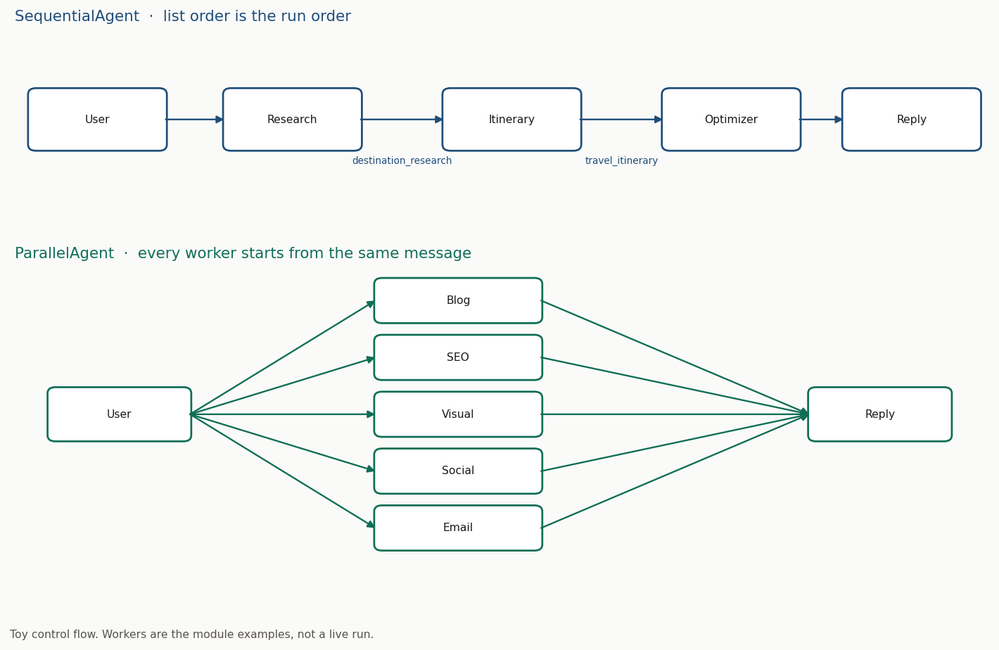

# Module 4: Sequential and Parallel Agents

## Objectives

- A fixed pipeline so destination research, the itinerary, and the optimization run in that order
- A fan-out so blog, SEO, visual, social, and email work run at the same time
- Where a worker's reply is stored, and how the next instruction reads it
- What the orchestrator takes, and the variable name ADK loads
- How finished parallel replies fold into one result for the user
- Which dev UI panels show the worker, the tool call, and the handoff, so you can debug and check the interactions

## Key concepts

| Term | Definition / notes |
| ---- | ------------------ |
| `SequentialAgent` | Runs `sub_agents` **one after another**. List order is the run order |
| `ParallelAgent` | Sub-agents run their tasks **at the same time**, **independently**. Each has its own branch; events merge as branches return |
| `sub_agents` | The **worker list** on the orchestrator. Each entry is an `Agent` |
| `output_key` | **Session-state key** for that worker's final text. Later steps and tools read it by this name |
| `{key}` | Instruction placeholder. ADK replaces it with **state[`key`]**. A missing key raises `Context variable not found` |
| `google_search` | Built-in tool from `google.adk.tools`. The worker that should search lists it in `tools` |
| `root_agent` | The **orchestrator** and the **entry point** ADK runs. Assign the workflow to this name |
| Token streaming | Dev UI switch that shows **tokens as each worker writes** |
| Event | One step of the run: **author**, tool call, request, response |

## Sequential and parallel

`SequentialAgent` and `ParallelAgent` are workflow agents. Used when the path is fixed. They solve who runs, and whether the next worker waits.

| | What it is | Why it is needed | When it is used | How you notice |
| --- | ---------- | ---------------- | --------------- | -------------- |
| `SequentialAgent` | Sub-agents run in **list order**. Each finish is the next worker's input | A later step needs the earlier reply | Research, then a plan, then a rewrite | Events follow the list: author 1, then author 2, then author 3 |
| `ParallelAgent` | Sub-agents execute **at the same time**, **independently**. Each branch sees the lead-in and its own events | Independent jobs finish together | Several specialists, same user request, separate `output_key`s | Five authors in Events. Each one you open is a different worker |

Name cue: **sequential** is one after another, in the order written in `sub_agents`. **Parallel** is alongside; list order is only how you read the file.

Both take `name`, `description`, and `sub_agents`. `model`, `instruction`, and `tools` stay on each worker. `SequentialAgent` has no `model` field (`BaseAgent` rejects unknown fields), so a `model=` there fails at startup.

Build every worker, and attach each worker's tools, before the run starts. The `sub_agents` list is that assembly. Names, models, instructions, and tools are already set, so every resource the workflow needs is available and configured when execution begins.

A worker that must read another worker's `output_key` goes in the sequential list, after the writer. A parallel branch sees the events up to the fan-out and its own events. Session state is shared across branches, so give each worker its own `output_key` or a later write replaces the earlier one.

```bash
cd code/workflow
python workflow_agents.py
```



## Travel pipeline

Three workers, one `SequentialAgent`. The full instructions are in [`code/adk_agents/multi_agents/agent.py`](../code/adk_agents/multi_agents/agent.py).

| Order | Worker | Tools | `output_key` | What it reads |
| ----- | ------ | ----- | ------------ | ------------- |
| 1 | `DestinationResearchAgent` | `google_search` | `destination_research` | The user message: destination, dates, budget, interests |
| 2 | `ItineraryBuilderAgent` | — | `travel_itinerary` | `destination_research` |
| 3 | `TravelOptimizerAgent` | — | — | `{travel_itinerary}` already in state. Its reply is the user-facing plan |

Research covers weather, sights, customs, local transport, and safety. The itinerary is day-by-day: activities, area to stay, time, meals, budget. The optimizer adds money-saving tips, packing, backup plans, and local resources, and is told the section headings to use: itinerary, optimization tips, travel essentials, backup plans.

```python
from google.adk.agents import Agent, SequentialAgent
from google.adk.tools import google_search

research = Agent(
    name="DestinationResearchAgent",  # identifier, no spaces
    model="gemini-2.0-flash",
    tools=[google_search],            # only this worker searches
    description="Researches a destination.",
    instruction="Research weather, sights, customs, transport, and safety.",
    output_key="destination_research",
)

itinerary = Agent(
    name="ItineraryBuilderAgent",
    model="gemini-2.0-flash",
    description="Builds a day-by-day plan from destination_research.",
    instruction="Using destination_research, write the day-by-day plan.",
    output_key="travel_itinerary",
)

optimizer = Agent(
    name="TravelOptimizerAgent",
    model="gemini-2.0-flash",
    description="Adds budget, packing, and backup advice.",
    instruction="""Using the itinerary already stored, add practical advice.

    ITINERARY: {travel_itinerary}
    """,
)

# ADK loads this name. List order is the run order.
root_agent = SequentialAgent(
    name="TravelPlanningSystem",
    description="Researches a destination, builds an itinerary, then optimizes it.",
    sub_agents=[research, itinerary, optimizer],
)
```

Swap two entries in `sub_agents` and that new first worker runs first, before any research exists.

`output_key` stores the worker's final text on the session under that string. The next instruction names the key so the model knows which block to use. `{travel_itinerary}` is a state lookup, so it works only after `ItineraryBuilderAgent` has written it.

A prompt that gives the pipeline something to split: destination, trip length, dates, budget, interests, where to stay, and constraints such as language or customs. Token streaming shows research text before the later workers finish.

## Content system

Five workers, one `ParallelAgent`. Same user request, five independent jobs. The full search plans are in [`code/adk_agents/parallel_agents/agent.py`](../code/adk_agents/parallel_agents/agent.py).

| Worker | `output_key` | What it writes |
| ------ | ------------ | -------------- |
| `TrendAwareBlogWriterAgent` | `blog_content` | Trend-aware post, about 800–1200 words, with headlines and keywords |
| `TrendAwareSEOAgent` | `seo_strategy` | Trending keywords, titles, structure, competitor gaps |
| `TrendAwareVisualAgent` | `visual_content` | Formats, palettes, and a visual calendar from viral patterns |
| `TrendAwareSocialAgent` | `social_strategy` | Platform posts, hashtags, timing, engagement tactics |
| `TrendAwareEmailAgent` | `email_campaigns` | Subject lines, sequences, and lead magnets from industry news |

Each worker uses `model="gemini-2.0-flash"` and `tools=[google_search]`. The instruction is the search plan: which queries to run (trends, viral posts, industry news, seasonal angles, competitors), then what to write from those results.

`google_search` is the tool. A second Python tool whose body calls search again duplicates that call and the run rejects the shape. Put the query list in the instruction and pass `google_search` once.

```python
from google.adk.agents import Agent, ParallelAgent
from google.adk.tools import google_search

blog = Agent(
    name="TrendAwareBlogWriterAgent",
    model="gemini-2.0-flash",
    tools=[google_search],
    description="Writes a trend-aware blog post.",
    instruction="Search current trends for the user's topic, then write the post.",
    output_key="blog_content",
)

# seo, visual, social, and email follow the same shape, each with its own output_key.

root_agent = ParallelAgent(
    name="TrendAwareContentCreationSystem",
    description="Trend-based content for blog, SEO, visual, social, and email.",
    sub_agents=[blog],  # plus the other four; list order is for reading the file
)
```

Leave the topic as ordinary words in the instruction. `{topic}` looks up state. Nothing in this system writes `topic`, so the run stops with `Context variable not found: topic`. The user message is already in the request, and each worker takes the subject from that text. Keep each `output_key` for a later sequential step, a tool, or a callback.

## Collecting parallel outputs

When the branches finish, aggregate every worker's reply into **one organized result** for the user or the next system. In this content system the five `output_key` values are the blocks of that result.

```python
# After the parallel run. Toy of the assembled result, not a live call.
result = {
    "blog": state["blog_content"],
    "seo": state["seo_strategy"],
    "visual": state["visual_content"],
    "social": state["social_strategy"],
    "email": state["email_campaigns"],
}
```

## Run and inspect

Each workflow is its own package: `agent.py`, `.env`, and `__init__.py` with `from . import agent`. `adk web` is started from the directory that contains the packages. One package opens directly. Two or more (`multi_agents` and `parallel_agents`) and the UI asks which one to open.

```bash
# from code/adk_agents
adk web
```

Turn on token streaming, then send the trip or the content brief. The server keeps a session id for that conversation and writes a debug trace.

Read Events on a complex run. Author, tool, request, and response are how you debug a failure, tighten a step that is slow or weak, and confirm the agents interacted as you configured them.

| In Events | What it is |
| --------- | ---------- |
| Author | Worker name. Sequential authors follow `sub_agents`. Parallel authors are the branches that have returned |
| Tool | `google_search` on the research worker, and on every content worker. The itinerary and optimizer have none |
| Request | That worker's instruction, model id, and the user text |
| Response | That worker's reply. Sources from search show up on the research events |

The parallel panel still lists events one by one so you can open them. The branches ran together. Event numbers follow whichever branch returned.
