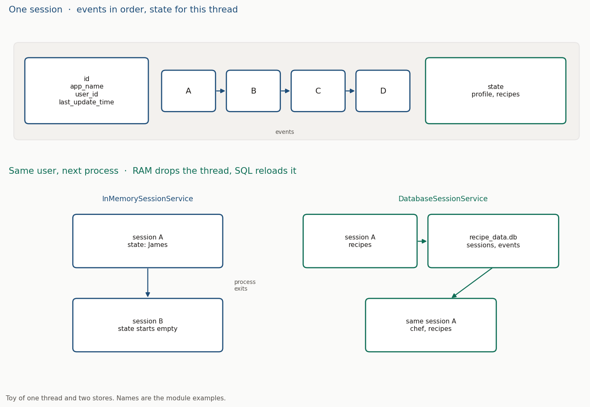

# Module 5: Session, Memory, and Structured Outputs

## Objectives

- Session, state, and memory so a multi-turn agent keeps what was already said
- The session object, and which service stores the thread
- An in-memory customer agent that reads a profile from state
- A schema so the reply is always the same fields
- A database recipe agent whose collection is still there after you quit

## Key concepts

| Term | Definition / notes |
| ---- | ------------------ |
| Session | The **current conversation thread**. One ongoing interaction |
| State | **Data stored on that session**. Profile, recipe list, anything this thread should recall |
| Memory | **Searchable archive across sessions**. Past or external context a later thread can look up |
| Event | One **step in time order**: user text, model reply, tool result, or a state write |
| `SessionService` | **Initiates the session**, then loads and stores it. The class you pick is the storage backend |
| `InMemorySessionService` | Thread store **in process RAM**. `adk web` uses this. Exit the process and the threads are gone |
| `DatabaseSessionService` | Thread store in a **relational database**. The next process loads the same `id` |
| `VertexAiSessionService` | Thread store on **Vertex AI**. Cloud persistence for an app that lives in that project |
| `Runner` | Handles **input and output** with the agent and runs the turn **asynchronously**. Binds the agent to an app name and a session service |
| `output_schema` | Pydantic model the reply **must match** |
| `output_key` | State key where that **structured reply is written** |
| `tool_context` | Handle a tool uses to **read and write** `state` on the current session |
| `{key}` | Instruction placeholder. ADK replaces it with **state[`key`]** |

## Session, state, and memory

Session, state, and memory are how an agent holds context. Used when the conversation is more than one turn. They solve continuity: the agent recalls what was said and skips asking for it again.

| | What it is | Why it is needed | When it is used | How you notice |
| --- | ---------- | ---------------- | --------------- | -------------- |
| Session | One thread. Events land in the order they happen | Something has to own the turns | Every run, including `adk web` | A session id. A new id is a new thread |
| State | Dict on that session: name, orders, recipes | Facts this conversation should keep | Seeded in `create_session`, updated by tools or `output_key` | `session.state`. A new id starts from the dict you pass in |
| Memory | Searchable store that outlives one thread | Recall from an earlier conversation, or from an outside archive | A knowledge base the agent queries | A later session can find what an earlier one saved |

Name cue: **session** is this sitting. **State** is the data of that sitting. **Memory** is the archive a later sitting can search.

Session and state are the live interaction: history and data of one active thread. Memory is older or external material: an archive, a database, or text.

`SessionService` manages threads through the session object. The memory service saves session material into that searchable archive. The scripts in this module use `SessionService`.

## The session object

`InMemorySessionService`, `VertexAiSessionService`, and `DatabaseSessionService` all return the same object. These fields are the ones to read.

| Field | What it holds |
| ----- | ------------- |
| `id` | **Uniquely identifies and manages** one user interaction or conversation. You pass one, or the service generates it |
| `app_name` | Which app owns the thread |
| `user_id` | Which user owns the thread |
| `events` | History, oldest first. Empty until a turn is appended |
| `state` | Dict for this thread. The initial dict is the `state=` you passed |
| `last_update_time` | Unix timestamp of the latest update |

The session service initiates the session. `create_session`, `get_session`, `list_sessions`, and `delete_session` are async and keyword-only. Wrap them in `async def` and start with `asyncio.run`.

```python
import asyncio
import uuid
from google.adk.sessions import InMemorySessionService

async def main():
    service = InMemorySessionService()
    session = await service.create_session(
        app_name="my_app",
        user_id=f"user_{uuid.uuid4()}",
        state={"initial_key": "hello world"},  # data for this thread only
        session_id=str(uuid.uuid4()),
    )
    # session.id, app_name, user_id, state, events, last_update_time
    await service.delete_session(
        app_name=session.app_name,
        user_id=session.user_id,
        session_id=session.id,  # each thread has its own id
    )

asyncio.run(main())
```

`delete_session` is optional cleanup. A later `get_session` for that id returns `None`.

`adk web` builds this object for the session id shown in the UI. In that id, "my name is James" lands in state, so "what's my name?" can answer. Open another session id and that thread starts from its own state.

## Where the thread is stored

`InMemorySessionService`, `VertexAiSessionService`, and `DatabaseSessionService` are `SessionService` backends. Used when you choose where the thread lives. They solve how long the session survives.

| | What it is | Why it is needed | When it is used | How you notice |
| --- | ---------- | ---------------- | --------------- | -------------- |
| `InMemorySessionService` | RAM store for the process | A thread with no database to set up | Scripts, and `adk web` | Quit the process and every session is gone |
| `VertexAiSessionService` | Vertex AI session store | The thread lives in a Google Cloud project | An app deployed on Vertex | The session remains in that project after the process exits |
| `DatabaseSessionService` | SQL store behind a URL you pass as `db_url` | The next process must load the same thread | The recipe agent, or any collection that should survive a restart | A database file. Tables `sessions`, `events`, `app_states`, `user_states` |

Name cue: **in-memory** is the process's RAM. **Vertex** is Google's cloud session store. **Database** is the SQL URL.

`adk web` uses `InMemorySessionService`. The UI hides the service; leaving that process drops the thread.

```bash
cd code/session_memory
python session_memory.py
```



## In-memory customer agent

The runnable file is [`code/adk_agents/session_state_runner/session_object.py`](../code/adk_agents/session_state_runner/session_object.py). It is a toy profile, one customer, one question.

`load_dotenv()` runs first. This file is plain Python, so the keys in the package `.env` have to be loaded here. `adk web` loads that file for you.

| Step | Call | Why |
| ---- | ---- | --- |
| Store | `InMemorySessionService()` | Holds the thread for this process |
| Seed | `create_session(..., state=customer_data)` | The profile is state before the first turn |
| Bind | `Runner(agent=..., app_name=..., session_service=...)` | Handles input and output with the agent, and the async run |
| Ask | `types.Content(role="user", parts=[types.Part(text=...)])` | The turn the runner appends. Import `types` from `google.genai` |
| Run | `runner.run_async(user_id=..., session_id=..., new_message=...)` | Walk events. `is_final_response()` then `content.parts[0].text` |
| Read | `get_session(app_name=..., user_id=..., session_id=...)` | State after the turn |

The agent greets Sarah by name because it reads her profile from session state. The instruction names those keys in braces, and ADK fills `{customer_name}`, `{favorite_category}`, `{recent_order}`, and `{loyalty_points}` from the dict passed to `create_session`.

```python
from google.genai import types
from google.adk.runners import Runner

customer_data = {
    "customer_name": "Sarah Johnson",
    "favorite_category": "Electronics",
    "recent_order": "iPhone 15 Pro - Order #12345 - Shipped",
    "loyalty_points": 500,
}

runner = Runner(
    agent=support_agent,
    app_name="TechStore",
    session_service=session_service,  # the store that holds customer_data
)

message = types.Content(
    role="user",
    parts=[types.Part(text="Hi! Can you check my recent order status?")],
)
```

```bash
cd code/adk_agents
uv run session_state_runner/session_object.py
```

## Structured output

A Pydantic `BaseModel` is the reply shape. `Field(description=...)` is the hint the model uses to fill that field, so the description should say what the value means.

`output_schema` makes the reply match the model. `output_key` is the state key that receives it. Here the key is `"state"`, so the object lands at `session.state["state"]`.

```python
from pydantic import BaseModel, Field

class CustomerStateOutput(BaseModel):
    customer_name: str = Field(description="Full name of the customer.")
    favorite_category: str = Field(description="Preferred product category.")
    recent_order: str = Field(description="Latest order: product, number, status.")
    loyalty_points: int = Field(
        description="Current loyalty points.",
        ge=0,  # a negative count fails validation
    )

support_agent = Agent(
    name="CustomerSupport",
    model="gemini-2.0-flash",
    instruction="You are support for TechStore. Customer: {customer_name}. ...",
    output_schema=CustomerStateOutput,  # reply fields are exactly these
    output_key="state",                  # written to session.state["state"]
)
```

After the final event, read it back:

```python
session = await session_service.get_session(
    app_name=APP_NAME, user_id=CUSTOMER_ID, session_id=SESSION_ID
)
structured = session.state["state"]  # customer_name, favorite_category, recent_order, loyalty_points
```

`loyalty_points` is an `int` on the model, so the saved value is a number. The four keys stay in that shape on every run.

The schema write is the `output_key`. The demo then copies those keys onto the top-level state and deletes `"state"`, so the fields sit beside the original profile.

## Persistent recipe agent

`DatabaseSessionService` writes the thread to SQL, so the next process can load it. Used when a collection has to outlive one run. It solves the RAM limit: quit, start again, the recipes are in the file.

The runnable file is [`code/adk_agents/persistent_agent/agent.py`](../code/adk_agents/persistent_agent/agent.py). The recipes are a toy collection in a local SQLite file.

```python
DB_URL = "sqlite+aiosqlite:///./recipe_data.db"  # async driver; path is the process cwd
service = DatabaseSessionService(db_url=DB_URL)
```

`aiosqlite` matches the async service methods. The same class takes another SQLAlchemy URL (MySQL and the rest). `./recipe_data.db` is created in the working directory, so run from `persistent_agent` and the file sits next to `agent.py`.

`APP_NAME` and `USER_ID` are the row keys. Initial state is `chef_name`, `total_recipes` `0`, and `recipes` `[]`.

- Call `list_sessions(app_name=..., user_id=...)`.
- The list is oldest first. The last id is the active thread. Continue that id.
- An empty list means `create_session` with the initial state, then keep `session.id`.

The instruction names each tool, the arguments, and when to call it, and it includes `{chef_name}` and `{total_recipes}` so the model sees the current state. Example phrasings in the instruction ("add my pasta recipe") are what steer the tool choice.

| Tool | Arguments | What it writes back |
| ---- | --------- | ------------------- |
| `add_recipe` | `name`, `ingredients`, `instructions`, `cook_time` (default 30 minutes) | Appends one recipe dict: name, ingredients, instructions, cook time, date added |
| `view_recipes` | — | The saved list |
| `get_recipe` | `name` | One recipe, match ignoring case |
| `delete_recipe` | `name` | The list with that name removed |
| `search_recipes` | `ingredient` | Recipes whose ingredients contain that string |

Listing and retrieving recipes stays coherent across turns because the session keeps that conversational state. `tool_context.state` is the write path: read the list, change it, write the list and the count back. ADK persists that delta with the turn.

```python
def add_recipe(name, ingredients, instructions, cook_time="30 minutes", tool_context=None):
    """Add a new recipe to the collection."""  # the model reads this to decide the call
    recipe = {
        "name": name,
        "ingredients": ingredients,
        "instructions": instructions,
        "cook_time": cook_time,
        "date_added": time.strftime("%Y-%m-%d"),
    }
    recipes = list(tool_context.state.get("recipes", []))
    recipes.append(recipe)
    tool_context.state["recipes"] = recipes          # session state, persisted with the turn
    tool_context.state["total_recipes"] = len(recipes)
    return {"action": "add_recipe", "recipe": recipe, "total_recipes": len(recipes)}
```

When the tool has no `tool_context`, write the delta yourself: `get_session`, build an `Event` whose `actions` carry `state_delta`, then `append_event`. That append is what commits the change onto the session and into the database.

```python
from google.adk.events.event import Event
from google.adk.events.event_actions import EventActions

await service.append_event(
    session=session,
    event=Event(
        invocation_id=str(uuid.uuid4()),
        author="recipe_agent",
        actions=EventActions(state_delta={"recipes": recipes}),
    ),
)
```

A turn is the same `types.Content` as the customer agent, passed to `runner.run_async(user_id=..., session_id=..., new_message=...)`. Print the text on the event where `is_final_response()` is true.

The file opens with these tables:

| Table | What you read there |
| ----- | ------------------- |
| `sessions` | `app_name`, `user_id`, `id`, and `state` (chef name, recipes, count) |
| `events` | Each turn: author, timestamp, invocation id, message parts |
| `app_states` | State stored for the app |
| `user_states` | State stored for the user |

Quit and run the script again. `list_sessions` returns the same id, so "what is my name?" reads `chef_name` Alice and the recipe tools read the list saved on that session.

```bash
cd code/adk_agents/persistent_agent
uv run agent.py
```
