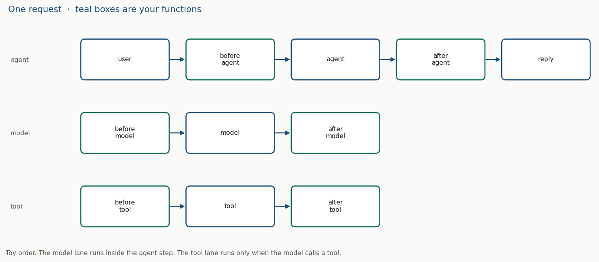

# Module 6: Callback Functions - Filtering and Guardrails

## Objectives

- A function ADK calls before or after the agent, the model, or a tool
- `None` lets that step run; a returned value skips the step or replaces its result
- A start time on session state, and a keyword block that never calls the model
- The same return rule on a tool: a dict skips the call or replaces the tool result
- The FastAPI server: list the apps, create the session, then `POST /run`

## Key concepts

| Term | Definition / notes |
| ---- | ------------------ |
| Callback | A **function you attach** when you build the agent. ADK calls it at that point in the request |
| `CallbackContext` | Handle for agent and model callbacks. **`user_content`** is this turn. **`state`** is the session dict |
| `before_agent_callback` | Runs **before the agent's work** for this request |
| `after_agent_callback` | Runs **after the agent finishes**, before the result goes on |
| `LlmRequest` | The payload **about to be sent** to the model. `contents` holds the parts |
| `LlmResponse` | The model reply, or the **stand-in you return** so the model is not called |
| `before_model_callback` | Runs **before the model call**. Reads `LlmRequest` |
| `after_model_callback` | Runs **after the model reply**, before that reply is used |
| `before_tool_callback` | Runs **before the tool function**. Receives the tool, its args, and `tool_context` |
| `after_tool_callback` | Runs **after the tool returns**. Receives the tool dict as well |
| Guardrail | A callback that **validates, filters, or blocks** so a disallowed step does not run |
| `adk api_server` | **FastAPI** for the same apps as `adk web`. Routes live at `/docs` |

## Agent, model, and tool callbacks

Agent, model, and tool callbacks are checkpoints on one request. Used when you need to log, rewrite, or stop a step. They solve guardrails, debugging, and data changes from functions you attach.

| Use | What you do |
| --- | ----------- |
| Diagnostics | Log inside `before_agent_callback` and store the **request start time** |
| Duration | Compare that start time with the **end time** taken in `after_agent_callback` |
| Filter | Read the original request. Return a **custom response** when the query matches |
| Augment | Read the original response and change it before it is used |

The callback is given the **original request and response objects** so it can decide from them: filter, or augment.

A callback does not make the agent run faster. The same model and tool calls still happen, plus your function.

| | What it is | Why it is needed | When it is used | How you notice |
| --- | ---------- | ---------------- | --------------- | -------------- |
| Agent | `before_agent_callback`, `after_agent_callback` on the agent | Log, auth, input checks, timing, state writes around the whole request | Every user turn for that agent | Terminal prints, then the reply. `state["start_time"]` in the State panel |
| Model | `before_model_callback`, `after_model_callback` | Filter what is sent, or rewrite what comes back | Each time this agent is about to call the model | A refusal with an empty model trace, or a reply you altered |
| Tool | `before_tool_callback`, `after_tool_callback` | Block a tool, or replace its dict | Each time the model calls a registered tool | The tool function never runs, or Events shows your dict |

Name cue: **before** is the checkpoint at the start of that step. **after** is the checkpoint once the step has a result, before that result is passed on.

`Agent` and `LlmAgent` are the same class. Pass the functions on the constructor. A list runs in order until one callback returns a value that stops the chain.

```bash
cd code/callbacks
python callbacks.py
```



## What the return value does

| Hook | `None` | A value |
| ---- | ------ | ------- |
| `before_agent_callback` | The agent runs | `types.Content` — the agent run is skipped and that content is the reply |
| `after_agent_callback` | The agent's reply stays as it is | `types.Content` — appended as an extra agent response |
| `before_model_callback` | The request goes to the model | `LlmResponse` — the model is not called |
| `after_model_callback` | The model reply is kept | `LlmResponse` — replaces the model reply |
| `before_tool_callback` | The tool is called | A `dict` — the tool is not called. `{}` counts |
| `after_tool_callback` | The tool dict is kept | A `dict` — replaces the tool result. `{}` counts |

Agent and model callbacks stop the chain on a truthy return. Tool callbacks stop on any value other than `None`.

Other uses of the same hooks: print at the step you are debugging, call an external API, send a notification, cache a result, or write session state before the agent sees the turn.

## Before and after the agent

The runnable file is [`code/adk_agents/agent_callback/agent.py`](../code/adk_agents/agent_callback/agent.py). It is a toy tutor: it times the turn, prints, and leaves the reply as the agent wrote it.

Logging in `before_agent_callback` captures the start time for diagnostics. Store it on `callback_context.state`. `after_agent_callback` takes the end time and subtracts. That difference is how long the agent took.

| Callback | Reads | Writes | Returns |
| -------- | ----- | ------ | ------- |
| `before_agent_callback` | `callback_context.user_content` | `state["start_time"] = datetime.now()` | `None` |
| `after_agent_callback` | `state["start_time"]` | nothing | `None` |

```python
def before_agent_callback(callback_context: CallbackContext) -> Optional[types.Content]:
    callback_context.state["start_time"] = datetime.now()  # State panel shows this key
    return None  # the agent still runs


def after_agent_callback(callback_context: CallbackContext) -> Optional[types.Content]:
    started = callback_context.state["start_time"]
    # duration is printed here; it is not written back to state
    print(datetime.now() - started)
    return None  # the reply is left as the agent wrote it


root_agent = LlmAgent(
    name="math_tutor",
    # ...
    before_agent_callback=before_agent_callback,
    after_agent_callback=after_agent_callback,
)
```

```bash
cd code/adk_agents
adk web
```

Open `agent_callback`. Events has the user text. State has `start_time`. The terminal has the before-line, then the after-line with the elapsed time. Trace is the invocation timing for that turn.

## Before and after the model

The runnable file is [`code/adk_agents/model_callback/agent.py`](../code/adk_agents/model_callback/agent.py). The keyword list is a toy filter, not a safety classifier.

A question is blocked by **returning a custom response** when a keyword is detected in the user's query. Pass the original `llm_request` and `llm_response` into the callbacks: the filter decides from the request text, and the augmentation decides from the response text.

`before_model_callback(callback_context, llm_request) -> Optional[LlmResponse]`

- Walk `llm_request.contents` for `role == "user"` and read `parts[0].text`.
- This loop **keeps the first user part** and then breaks. Later turns in the same session still see that first text.
- If any keyword is a substring of that text, return an `LlmResponse`. The model is not called. State stays empty for that turn.
- Otherwise return `None`.

The toy keywords are `math`, `calculate`, `+`, `-`, `*`, `/`, `=`, `plus`, `minus`, `times`, `divided`. `"-"` matches any hyphen. A real list is whole words, or a lookup, and it checks the **latest** user part.

```python
def before_model_callback(callback_context, llm_request):
    user_message = ""
    for content in llm_request.contents or []:
        if content.role == "user" and content.parts:
            user_message = content.parts[0].text  # first user part, then break
            break
    if any(word in user_message.lower() for word in MATH_KEYWORDS):
        return LlmResponse(  # stand-in reply; the model call does not happen
            content=types.Content(
                role="model",
                parts=[types.Part(text="Sorry, I'm not allowed to help with math problems right now.")],
            )
        )
    return None
```

`after_model_callback(callback_context, llm_response) -> Optional[LlmResponse]`

- Read `llm_response.content.parts[0].text`.
- Return a new `LlmResponse` with your text appended. This example adds ` 🤖`.
- Return `None` when there is no text to change. The original reply is kept.
- A blocked turn never reaches this callback, because `before_model_callback` already returned a response.

| User text | What runs |
| --------- | --------- |
| `What's 2 + 2?` | `before_model` returns the refusal. The model call is skipped |
| `What is the weather like today?` | Model runs, then `after_model` appends the emoji |
| A later turn in the same session, after a math question | Still blocked. The filter is still looking at the first user part |

## Tool callbacks

Same attach point, different arguments. Look these up as `before_tool_callback` and `after_tool_callback` on `LlmAgent`.

| Callback | Arguments | Return |
| -------- | --------- | ------ |
| `before_tool_callback` | `tool`, `args`, `tool_context` | `None` calls the tool. Any `dict` is the result instead |
| `after_tool_callback` | `tool`, `args`, `tool_context`, `tool_response` | `None` keeps the tool dict. A `dict` replaces it |

```python
def before_tool_callback(tool, args, tool_context):
    if tool.name == "get_weather":
        return {"status": "blocked"}  # get_weather is not called
    return None


root_agent = LlmAgent(
    # ...
    tools=[get_weather],
    before_tool_callback=before_tool_callback,
)
```

`tool_context` is the tool's handle on the current session, the same idea as `CallbackContext` for the agent hooks.

## ADK commands and the API server

`adk web`, `adk run`, and `adk api_server` load the same packages. Used when you want the UI, a terminal, or HTTP. They solve talking to an agent that already has `agent.py` and `root_agent`.

Run from the directory that **contains** the packages (`code/adk_agents`).

| Command | What you get |
| ------- | ------------ |
| `adk --help` | The command list |
| `adk --version` | The installed ADK version |
| `adk web` | Dev UI. Events, State, Trace |
| `adk run agent_callback` | Interactive CLI for one package |
| `adk create` | A new app in the current folder, files already filled in |
| `adk deploy` | The agent on a hosted environment |
| `adk eval` | Eval sets for an agent |
| `adk api_server` | FastAPI on `127.0.0.1:8000` |

`adk api_server` is unauthenticated. Keep it on localhost.

`http://127.0.0.1:8000/` has no page. `http://127.0.0.1:8000/docs` is the route list.

| Call | Body | Result |
| ---- | ---- | ------ |
| `GET /list-apps` | — | Package names: `agent_callback`, `model_callback`, and the other folders here |
| `POST /apps/{app}/users/{user}/sessions` | optional `{"session_id": "s1", "state": {}}` | Creates the session. Omit `session_id` and one is generated |
| `GET /apps/{app}/users/{user}/sessions/{id}` | — | That session. `404` when the id is missing |
| `DELETE /apps/{app}/users/{user}/sessions/{id}` | — | Drops it |
| `POST /run` | `app_name`, `user_id`, `session_id`, `new_message` | Events for one turn. `404` when that session was never created |

Create the session, then run. A missing session id on `/run` is `404`.

```bash
cd code/adk_agents
adk api_server
```

```bash
curl -s http://127.0.0.1:8000/list-apps

curl -s -X POST http://127.0.0.1:8000/apps/model_callback/users/u1/sessions \
  -H 'Content-Type: application/json' \
  -d '{"session_id":"s1"}'

curl -s -X POST http://127.0.0.1:8000/run \
  -H 'Content-Type: application/json' \
  -d '{"app_name":"model_callback","user_id":"u1","session_id":"s1","new_message":{"role":"user","parts":[{"text":"What is the weather?"}]}}'
```

`new_message` is a `google.genai` content object: `role` plus `parts`. A math question on `model_callback` comes back as the refusal from `before_model_callback`.
