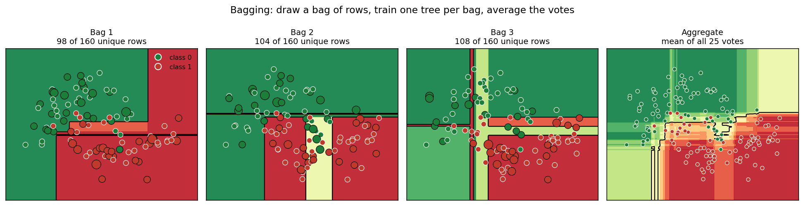
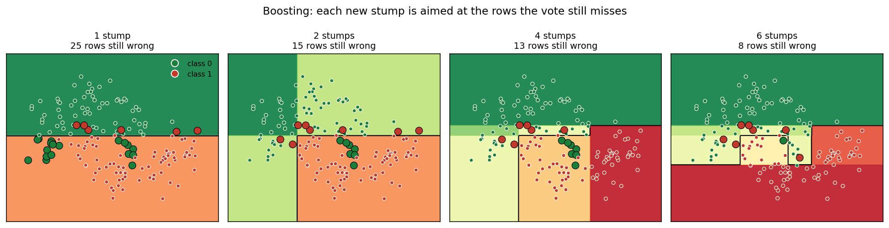
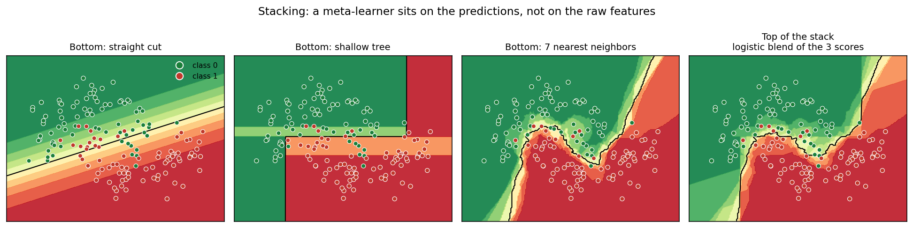
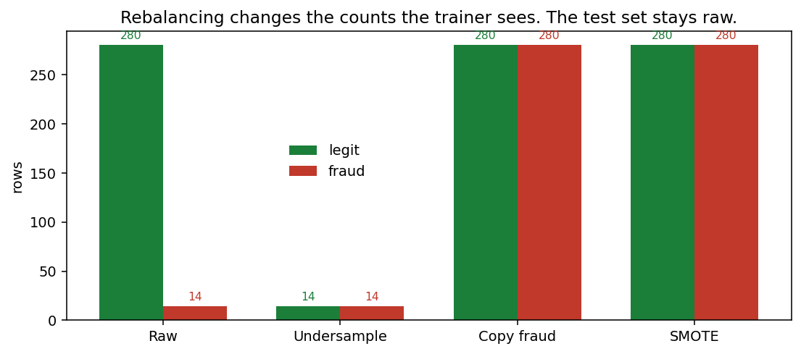
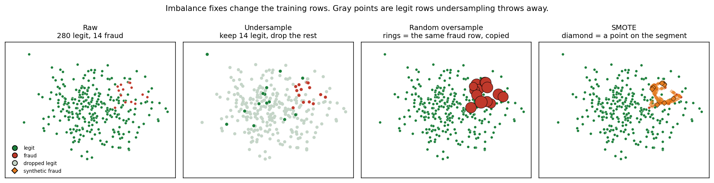
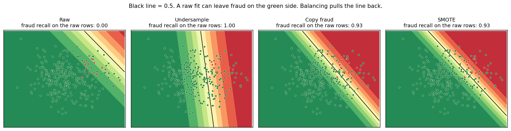
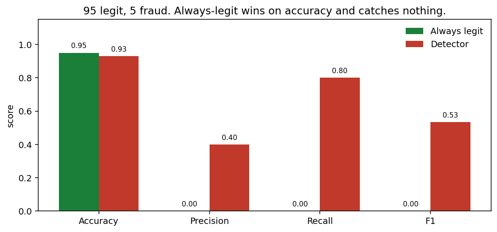
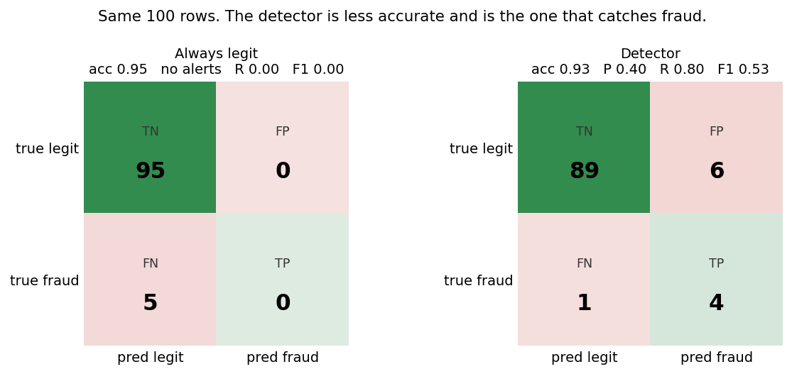
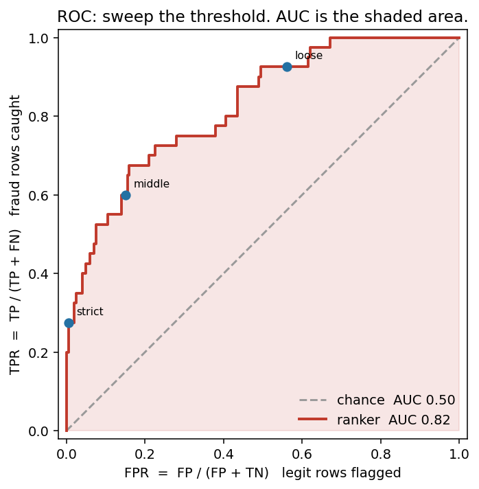

# Module 2: Fraud Prevention with Cloud AI Solutions

## Objectives

- Why card fraud is attractive, and the three ways it happens
- Detection finds it after; prevention stops it. Hybrids (rules + ML) beat either alone
- Cloud scale, PCA-masked features, RF vs XGBoost
- Imbalance breaks accuracy. Score with $F_1$ and ROC

## Key concepts

| Term | Definition / notes |
| ---- | ------------------ |
| Credit card fraud | Abuse of cards/credentials; rooted in identity theft; losses in the **billions** |
| Identity theft | Forged docs $\rightarrow$ fake/stolen identity $\rightarrow$ cards or account access |
| Fraud detection | Finds fraud **after** it happened |
| Fraud prevention | Stops fraud **before** (or as) it happens |
| Rule-driven model | Expert rules $\rightarrow$ score / deny / block; easy to ship; weak on **new** patterns |
| Data-driven model | ML on transaction data; correlates many features; often less explainable |
| Hybrid prevention | Rules + ML together; best of both; can update dynamically |
| False positive (FP) | Legitimate txn flagged as fraud |
| False negative (FN) | Real fraud missed |
| Cloud stack for fraud | IaaS + PaaS + SaaS + cognitive computing for scale/complexity |
| IBM Watson Studio | Cloud AI platform supporting predictive analytics & ensemble models (bagging, boosting, stacking) |
| PCA (Principal Component Analysis) | Unsupervised technique for dimensionality reduction & sensitive data anonymization |
| Class Imbalance | Distribution skewed heavily toward majority class ($N_{\text{legitimate}} \gg N_{\text{fraud}}$) |
| Random Undersampling | Decreasing majority class samples to equalize class ratios |
| Random Oversampling | Increasing minority class samples using synthetic data generation |
| Ensemble Learning | Combining multiple models (e.g., Bagging in Random Forest, Boosting in XGBoost) to improve accuracy |
| $F_1$ Score | Harmonic mean of Precision and Recall ($F_1 = 2 \cdot \frac{P \cdot R}{P + R}$) |
| ROC-AUC | Area Under the Receiver Operating Characteristic curve; plots $TPR$ vs $FPR$ across thresholds |

## Why fraud thrives

- **Low hanging fruit:** identity theft can start with forged documents; little deterrence.
- **Low pursuit risk:** keep theft under reporting thresholds $\rightarrow$ banks often won’t chase.
- **Reputation fear:** institutions may under-report so they don’t look weak publicly.
- **Who benefits:** often organized crime; funds money laundering / other crime.
- **Scale of defense:** effective tooling is complex $\rightarrow$ needs **cloud** resources.

```text
Forge ID → get card access → stay under thresholds → hard to prosecute
```

## Three fraud scenarios

| # | Scenario | Pattern |
| - | -------- | ------- |
| 1 | Steal physical card | Run up the balance |
| 2 | Steal number / PIN | Many **small** charges over time |
| 3 | Steal identity $\rightarrow$ new card | Legitimate-looking card on false ID; ongoing charges |

**Mitigation spectrum**

- Low end: **two-factor authentication (2FA)**
- High end: **ML + predictive analytics**

## Detection vs prevention

| | Detection | Prevention |
| - | --------- | ---------- |
| Timing | After fraud | Before / at transaction time |
| Goal | Find what happened | Stop it from succeeding |

Focus: **prevention**.

## Rule-driven vs data-driven models

### Rule-driven (expert)

- Experts define scoring rules, denials, and blocks from transaction traits.
- **Pros:** simple to implement.
- **Cons:** stale against novel fraud; typically **$\downarrow$ FN, $\uparrow$ FP**.

### Data-driven (ML)

- Learns from data; correlates many features dynamically.
- **Pros:** adapts; finds complex patterns.
- **Cons:** weaker **explainability**.

### Hybrid (preferred)

Combine both $\rightarrow$ use each method’s strengths and cover the other’s gaps.

| Alone | Hybrid effect |
| ----- | ------------- |
| Rules: fewer misses, more false alarms | ML helps **cut FPs** |
| ML: powerful but opaque | Rules keep clear, known controls |
| Static rules age poorly | Combo can be **updated dynamically** |

```text
Rules (known patterns, fewer FN)
  + ML (new patterns, fewer FP)
  = practical fraud prevention
```

## Why cloud?

Fraud tooling needs elastic compute and managed AI services:

| Layer | Role (study cue) |
| ----- | ---------------- |
| IaaS | Raw infra (compute, storage, network) |
| PaaS | Build/run ML & apps without managing servers |
| SaaS | Ready fraud / analytics products |
| Cognitive computing | Cloud AI services that reason over data at scale |

---

## IBM Watson: cloud fraud lab

Watson Studio is the cloud platform used here for **predictive / ensemble** fraud models. It supplies sampling tools plus **bagging, boosting, and stacking**.

Bagging, boosting, and stacking are **ensemble methods**: several models combined into one predictor. Used when a single fit is jumpy, too weak, or wrong on part of the rows. They solve that by averaging unstable votes, aiming the next model at the misses, or letting a top model choose which score to trust.

| Ensemble | Idea | Example here |
| -------- | ---- | ------------ |
| Bagging | Train trees in parallel on bootstrap samples; average votes | Random Forest |
| Boosting | Train sequentially; **reweight** samples that were wrong to cut bias | XGBoost |
| Stacking | Blend heterogeneous models with a meta-learner | mentioned, not the lab focus |

Name cue:

- **Bagging** = **b**ootstrap **agg**regating. Draw a bag of datasets (sample with replacement), train one model per draw, then aggregate the votes.
- **Boosting** = each next model **boosts** the rows the last one missed, so a weak learner becomes a strong one.
- **Stacking** = a stack of models. Base models sit on the bottom; a meta-learner on top learns from their predictions.

A single model is enough when its train and test scores are already close and good. An ensemble is for the case where one fit is jumpy, too weak, or blind on part of the data.

| | What it is | Why it is needed | When it is used | How you notice |
| - | ---------- | ---------------- | --------------- | -------------- |
| **Bagging** | Many models, each on its own bootstrap sample, vote together | One unstable model (a deep tree) memorizes whichever rows it saw. Averaging those votes cancels the jumps | Noisy data, high-variance bases, and when trees can train in parallel. Here: Random Forest | Retrain the same tree on a new split and the test score moves a lot. Train looks excellent, test does not |
| **Boosting** | Models in a sequence. Each one is aimed at the rows the last one missed | A weak model keeps missing the same hard rows (often the rare class). Reweighting those rows cuts that bias | Tabular problems where accuracy on the hard cases matters and training can be sequential. Here: XGBoost on card fraud | Train and test are both weak, or the misses pile up on one group (fraud) while the easy majority looks fine |
| **Stacking** | A model on top of other models’ scores | Each model type is wrong on a different slice. The top model learns which score to trust | You already have a few decent, different models, and no one of them wins on every row. Watson lists it; this lab does not run it | Model A beats model B on one segment, and loses on another. A blend of their scores beats the best single model on a held-out set |

Pictures of those three names, on two moons (green = class 0, red = class 1). Code: [`code/ensembles/ensembles.py`](../code/ensembles/ensembles.py).

```bash
cd code/ensembles
python ensembles.py
```



A larger dot with a ring was drawn more than once. The last panel is the mean of all 25 bag votes.



Rings mark rows the current vote still gets wrong. The next stump is fit to boost those.



The top model never sees the raw points. It only blends the three scores under it.

**Hands-on.** Account needs a card on file but is not charged. Slides + Chapter 7 notebook in the VM already show the output.

```text
Create Watson project
  → download notebook + creditcard dataset
    → upload both to project Assets
      → run cells like a local Jupyter notebook
```

## Dataset (31 features)

Most columns are confidential customer fields already transformed with **PCA** ($V_1,\ldots,V_{28}$). PCA both **shrinks dimensionality** and **masks** raw values so they are not recognizable. Remaining columns are typically `Time`, `Amount`, and label `Class`.

$$
z = W^\top (x - \mu)
$$

$W$ = top eigenvectors of $\mathrm{Cov}(X)$. Notebook applies **no further transforms** because this is already done.

Plot cue: **green = legitimate**, **red = fraud**. Far more green than red → **imbalanced**, but still enough fraud points to train on.

$$
N_{\text{legit}} \gg N_{\text{fraud}}
$$

No extra math transforms in the notebook: PCA already did that work.

## Analytic process (same for every experiment)

```text
Load → stats / viz (spread, imbalance, need for transforms?)
  → train/test split
    → train + hyperparameter optimization
      → score with F1 and ROC
```

EDA is there so you can decide: transform? rebalance? Here: **no transform**, later slides **do rebalance** to lift ML performance.

## Bagging vs boosting (why XGBoost beat RF)

Random Forest (bagging) treats trees as a vote. XGBoost (boosting) **ups the weight** of misclassified rows so later trees focus on hard cases and **reduce bias**.

$$
w_i^{(t+1)} \propto w_i^{(t)}\,\exp\!\big(\eta\,\mathbb{1}[y_i \neq \hat{y}_i^{(t)}]\big)
$$

| Piece | What it is |
| ----- | ---------- |
| $i$ | One training row |
| $t$ | The tree just fit. $t+1$ is the next tree |
| $w_i^{(t)}$ | How much row $i$ counted when tree $t$ was fit |
| $w_i^{(t+1)}$ | That row’s weight for the next tree |
| $\propto$ | “Proportional to.” After the multiply, weights are rescaled so they sum to $1$ |
| $y_i$ | True label of the row |
| $\hat{y}_i^{(t)}$ | Label predicted by tree $t$ |
| $\mathbb{1}[y_i \neq \hat{y}_i^{(t)}]$ | $1$ if tree $t$ missed the row, $0$ if it was right |
| $\eta$ | Learning rate. How hard a miss is boosted. Small $\eta$ = a gentle nudge |
| $\exp(\eta \cdot \mathbb{1}[\ldots])$ | A hit multiplies the weight by $\exp(0) = 1$ (unchanged). A miss multiplies it by $\exp(\eta) > 1$ |

Flow, one round of boosting:

- Start round $t$ with a weight on every row. Round $0$ uses equal weights.
- Fit tree $t$ so rows with a larger $w_i^{(t)}$ matter more.
- Compare $y_i$ with $\hat{y}_i^{(t)}$. Mark the misses.
- Build $w_i^{(t+1)}$ from the equation: misses grow by $\exp(\eta)$, hits stay put, then rescale.
- Fit tree $t+1$ on those new weights. It has to face the rows the last tree missed.
- Add that tree to the sequence. The model is the whole sequence, not the last tree.
- Stop after a set number of trees, or when the misses stop shrinking.

Study cue: RF = many independent trees; XGB = a sequence that keeps correcting errors.

## Class imbalance: under vs over

Undersampling and oversampling are **rebalancing methods**: they change how many rows of each class the trainer sees. Used when one class vastly outnumbers the other. They solve a model that looks accurate while missing almost every fraud row.

You notice it before any fancy model. Count the labels ($N_{\text{legit}} \gg N_{\text{fraud}}$). Then score a model that always says legit: accuracy is near $1$, fraud recall is $0$.

| | What it is | Why it is needed | When it is used | How you notice |
| - | ---------- | ---------------- | --------------- | -------------- |
| **Random undersample** | Keep every fraud row. Drop legit rows at random until the counts are close | The majority swamps the loss, so the fit can ignore fraud | You have legit rows to spare, and the score you care about is $F_1$ / ROC on the rare class. This lab: **best** | Always-legit accuracy looks solved, and a real model’s fraud recall stays near $0$ |
| **Random oversample** | Copy fraud rows, with replacement, until the counts match | You want the rare class to pull harder, and you still want every legit row in the fit | The minority is a handful of real cases you are willing to repeat | Same accuracy trap, and throwing away legit rows would discard too much |
| **SMOTE** (synthetic oversample) | Invent a fraud row on the line between a real fraud row and one of its fraud neighbors | A copied row is the same point again. A point between two fraud rows gives the fit a new place to see | Fraud rows form a neighborhood, not one isolated point. This lab: better than the raw mix, **behind undersampling** | Copies of the same few fraud rows start to be memorized, and the gap between them is still empty |

Class weights are the option that leaves the rows alone. `scale_pos_weight` $\approx N_{\text{legit}} / N_{\text{fraud}}$ makes each fraud row count more in the loss. That is experiment 2 (XGBoost), not a new sample.

SMOTE placement:

$$
x_{\text{new}} = x_i + \lambda (x_{zi} - x_i),\quad \lambda \in [0,1]
$$

| Piece | What it is |
| ----- | ---------- |
| $x_i$ | One real fraud row |
| $x_{zi}$ | A fraud neighbor of $x_i$ |
| $x_{zi} - x_i$ | The step from this fraud row to that neighbor |
| $\lambda$ | How far along the step. $0$ stays on $x_i$. $1$ lands on the neighbor |
| $x_{\text{new}}$ | The synthetic fraud row, on the segment between them |

Flow:

- Split first. Resample **train only**. The test set keeps the real legit/fraud mix.
- **Undersample:** count the fraud rows, draw that many legit rows, drop the rest, fit.
- **Random oversample:** count the gap $N_{\text{legit}} - N_{\text{fraud}}$, draw that many fraud rows with replacement, append the copies, fit.
- **SMOTE:** for each new row, pick a fraud row, pick a neighbor, draw $\lambda$, place $x_{\text{new}}$ with the formula. Append those rows, fit.
- Score with $F_1$ and ROC on the untouched test set. A higher fraud recall can also flag more legit rows; those two metrics are what decide the winner.

Pictures on a 2D cartoon (green = legit, red = fraud). Code: [`code/imbalance/imbalance.py`](../code/imbalance/imbalance.py).

```bash
cd code/imbalance
python imbalance.py
```





Gray points are legit rows undersampling drops. A ring is the same fraud row copied. A diamond is a new point on the segment between two fraud rows.



The black line is the $0.5$ cut of one logistic model. On the raw mix its fraud recall is $0$. Balancing moves the line so the real fraud rows fall on the red side. Recall here is on the original rows; the lab still picks the winner with $F_1$ and ROC.

```text
Raw:     [======== legit ========] [fraud]
Under:   [== legit ==] [fraud]
Copy:    [======== legit ========] [== copied fraud ==]
SMOTE:   [======== legit ========] [== synthetic fraud ==]
```

| Method | What it does | Lab result |
| ------ | ------------ | ---------- |
| **Random undersample** | Shrink **legit** toward the fraud count | **Best** $F_1$ / ROC |
| **Synthetic oversample** | Grow **fraud** with points between real fraud rows | Better than the raw mix; **behind undersampling** |

## Experiments (memorize this table)

Same pipeline each time. Metrics: **$F_1$** and **ROC**. No extra PCA/transforms.

| # | Model | Features | Sampling | $F_1$ / ROC vs others |
| - | ----- | -------- | -------- | --------------------- |
| 1 | RF | all | raw (imbalanced) | decent baseline |
| 2 | XGBoost | all | raw; **weighted** samples | **better than RF (#1)** |
| 3 | RF | **fewer** | raw | **worse than #1** (dropping features hurt RF) |
| 4 | RF | all | **undersample** legit | **best** |
| 5 | RF | all | **oversample** fraud (synthetic) | better than imbalanced; **not as good as #4** |
| 6 | XGBoost | **fewer** | raw | **better than oversampling (#5)** |

**Takeaways**

- Undersampling all-feature RF won.
- Cutting features hurt RF; XGBoost still did well with fewer features.
- Oversampling helped vs raw imbalance but lost to undersampling.

## Metrics (why not accuracy)

Accuracy, precision, recall, $F_1$, and ROC-AUC are **scores for a classifier**. Used when you have to decide whether the model is catching fraud. They solve the case where accuracy looks finished because almost every row is legit.

You notice that from the label counts and from one dumb baseline. $N_{\text{legit}} \gg N_{\text{fraud}}$, and a model that always says legit already has accuracy near $1$ with fraud recall $0$.

| | What it is | Why it is needed | When it is used | How you notice |
| - | ---------- | ---------------- | --------------- | -------------- |
| **Accuracy** | Share of rows whose label matches the prediction | Fine when both classes are common and both mistakes cost the same | A balanced problem, one threshold already chosen | Accuracy stays high while the fraud row of the matrix is empty |
| **Precision** $P$ | Of the fraud alerts, how many were real | A noisy queue buries the analyst | False alarms are the expensive mistake | Many alerts, few of them are fraud |
| **Recall** $R$ | Of the real fraud, how many you caught | A missed fraud is the expensive mistake | You would rather review an extra alert than miss the charge | Fraud rows sit in the false-negative cell |
| **$F_1$** | Harmonic mean of $P$ and $R$ | Dies if either one is near $0$, so it refuses the always-legit trick | Compare models on a rare positive class at one threshold | Accuracy looks strong and $F_1$ is near $0$ |
| **ROC-AUC** | Area under true-positive rate vs false-positive rate | One number for the whole threshold sweep, before you pick a cutoff | Compare rankers, or you have not chosen the alert threshold yet | One cutoff looks good and the next cutoff falls apart |

At one threshold the model turns a score into a label. The four counts are:

| Count | Meaning |
| ----- | ------- |
| TP | Fraud, and the model said fraud |
| FP | Legit, and the model said fraud |
| FN | Fraud, and the model said legit |
| TN | Legit, and the model said legit |

$$
\mathrm{Accuracy} = \frac{TP + TN}{N}
\qquad
P = \frac{TP}{TP + FP}
\qquad
R = \frac{TP}{TP + FN}
\qquad
F_1 = 2 \cdot \frac{P \cdot R}{P + R}
$$

| Piece | What it is |
| ----- | ---------- |
| $N$ | $TP + FP + FN + TN$, every row |
| $P$ | Precision. Alerts that were real fraud. If $TP + FP = 0$ the model never fired, so $P$ is undefined |
| $R$ | Recall. Real fraud that was caught. Same quantity as TPR |
| $F_1$ | Balances $P$ and $R$. If either is $0$, $F_1$ is $0$ |

ROC reads the same counts while the threshold moves:

$$
\mathrm{TPR} = \frac{TP}{TP + FN}
\qquad
\mathrm{FPR} = \frac{FP}{FP + TN}
\qquad
\mathrm{AUC} = \int_{0}^{1} \mathrm{TPR}(\mathrm{FPR}) \, d(\mathrm{FPR})
$$

| Piece | What it is |
| ----- | ---------- |
| TPR | Fraud catch rate at this threshold. Equal to recall |
| FPR | Share of legit rows that raised an alert at this threshold |
| One point on the curve | One threshold. Strict = few alerts (bottom-left). Loose = many alerts (toward the top) |
| AUC | Area under that path. $0.5$ matches ranking at random. Toward $1$ means fraud scores sit above legit scores |
| Reading of AUC | Chance a random fraud row outscores a random legit row |

Flow:

- Fit the model. Keep a score per row, not only a hard label.
- Pick a threshold. Score above it → fraud.
- Fill TP, FP, FN, TN.
- Compute accuracy, $P$, $R$, and $F_1$ at that one threshold.
- Sweep the threshold and plot TPR against FPR. That path is the ROC.
- Compare models by the area under it, and by $F_1$ at the threshold you would actually ship.

Worked counts: $95$ legit, $5$ fraud.

| Model | TN | FP | FN | TP | Accuracy | $P$ | $R$ | $F_1$ |
| ----- | -- | -- | -- | -- | -------- | --- | --- | ----- |
| Always legit | 95 | 0 | 5 | 0 | $0.95$ | no alerts | $0$ | $0$ |
| Detector | 89 | 6 | 1 | 4 | $0.93$ | $0.40$ | $0.80$ | $0.53$ |

Pictures for that pair, plus a threshold sweep. Code: [`code/metrics/metrics.py`](../code/metrics/metrics.py).

```bash
cd code/metrics
python metrics.py
```







Strict, middle, and loose are three thresholds on one ranker. The shaded area is the AUC. The diagonal is a ranker no better than chance.

## Code sketches

Shared setup:

```python
import pandas as pd
from sklearn.model_selection import train_test_split
from sklearn.ensemble import RandomForestClassifier
from sklearn.metrics import f1_score, roc_auc_score

df = pd.read_csv("creditcard.csv")
X, y = df.drop(columns=["Class"]), df["Class"]
X_tr, X_te, y_tr, y_te = train_test_split(
    X, y, test_size=0.2, stratify=y, random_state=42
)

def score(model, X_te, y_te):
    pred = model.predict(X_te)
    proba = model.predict_proba(X_te)[:, 1]
    return f1_score(y_te, pred), roc_auc_score(y_te, proba)
```

**#1 RF baseline (all features, imbalanced)**

```python
rf = RandomForestClassifier(n_estimators=100, random_state=42)
rf.fit(X_tr, y_tr)
print("RF baseline F1, ROC:", score(rf, X_te, y_te))
```

**#2 XGBoost (weights offset class imbalance / errors)**

```python
from xgboost import XGBClassifier

# scale_pos_weight ≈ n_neg / n_pos  (boost minority / hard cases)
spw = (y_tr == 0).sum() / (y_tr == 1).sum()
xgb = XGBClassifier(n_estimators=100, scale_pos_weight=spw, random_state=42)
xgb.fit(X_tr, y_tr)
print("XGB F1, ROC:", score(xgb, X_te, y_te))
```

**#3 / #6 fewer features** — drop columns before fit (hurts RF more than XGB):

```python
keep = ["V1", "V2", "V3", "Amount"]  # illustrative subset
rf.fit(X_tr[keep], y_tr)
```

**#4 undersample (best) / #5 synthetic oversample** — resample **train only**; score on original test:

```python
from imblearn.under_sampling import RandomUnderSampler
from imblearn.over_sampling import RandomOverSampler  # or SMOTE

X_u, y_u = RandomUnderSampler(random_state=42).fit_resample(X_tr, y_tr)
rf_u = RandomForestClassifier(n_estimators=100, random_state=42).fit(X_u, y_u)

X_o, y_o = RandomOverSampler(random_state=42).fit_resample(X_tr, y_tr)
rf_o = RandomForestClassifier(n_estimators=100, random_state=42).fit(X_o, y_o)

print("RF under:", score(rf_u, X_te, y_te))
print("RF over: ", score(rf_o, X_te, y_te))
```
