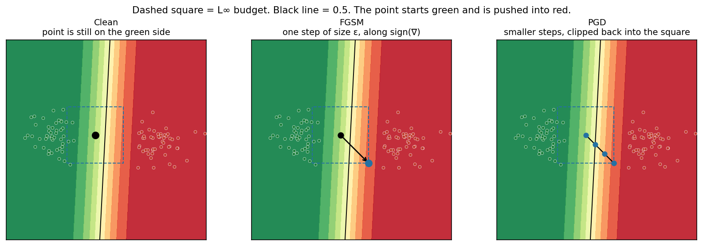
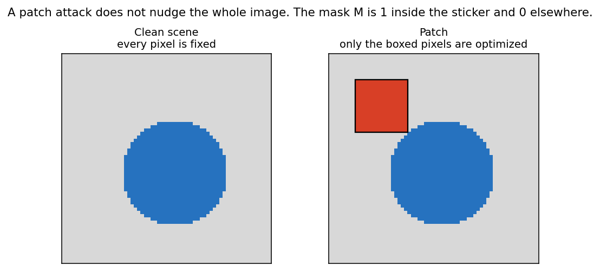
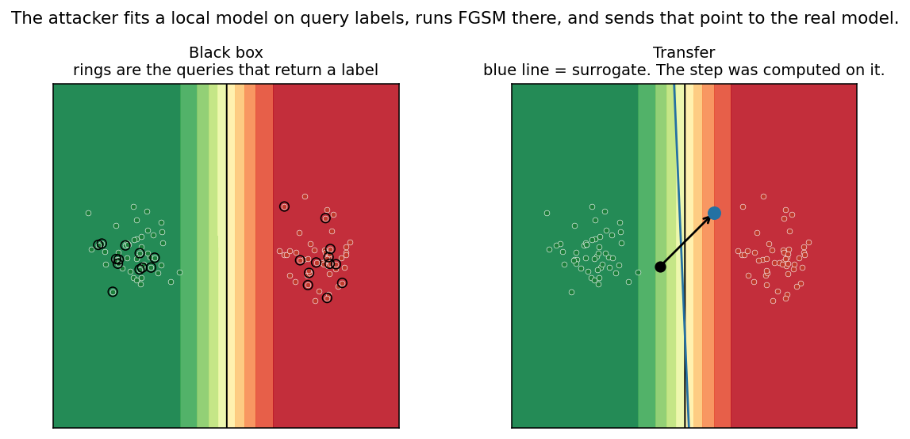
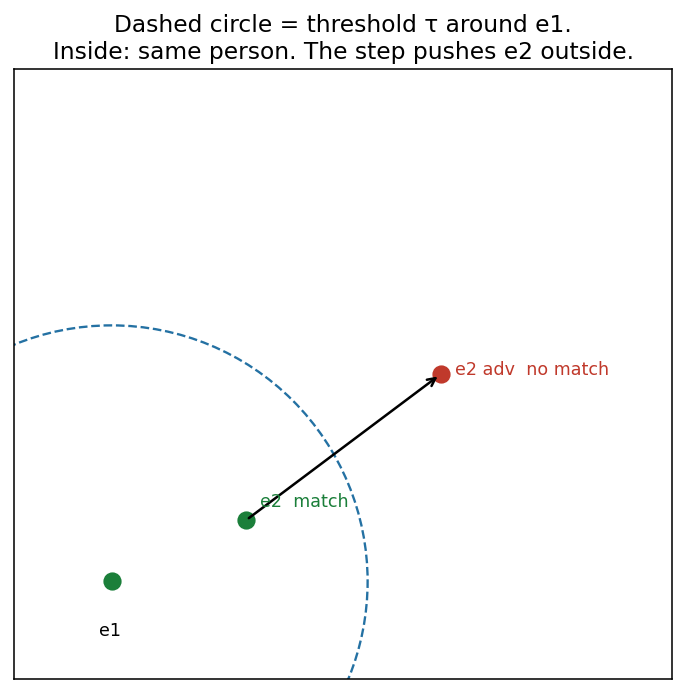
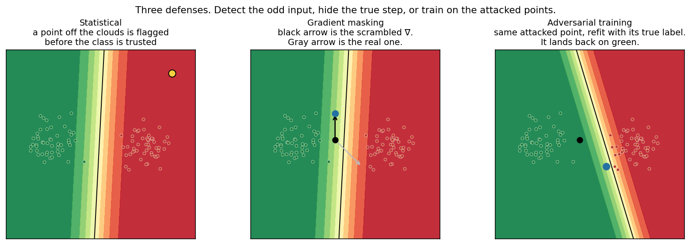

# Module 4: GANs and Adversarial Attacks

## Objectives

- A tiny, human-invisible change can flip a classifier
- White-box uses gradients (FGSM, PGD, patch). Black-box uses queries, a surrogate, and transfer
- Same idea against malware detectors, IDS, and Siamese face match
- Defend by detecting outliers, hiding gradients, or training on the attacks

## Key concepts

| Term | Definition / notes |
| ---- | ------------------ |
| Adversarial example | Tiny perturbation; looks normal to humans; model misclassifies |
| GAN logic (no GAN needed) | Attacker ≈ $G$; target NN ≈ $D$ that fails on perturbed $x$ |
| White-box | Architecture, weights, gradients, I/O known |
| Black-box | **Queries** only (input → labels / scores) |
| FGSM | One-step: $x + \varepsilon\,\mathrm{sign}(\nabla_x L)$ |
| PGD | Iterative FGSM + project into $\varepsilon$-ball |
| Adversarial patch | Localized sticker-like region; train over many images; often **targeted** |
| Targeted / untargeted | Force a **chosen** wrong class vs **any** wrong class |
| Model substitution | Query target → label data → train local surrogate |
| Transferability | Surrogate examples often fool the remote target too |
| Perturbation budget $\varepsilon$ | Max change (usually $L_p$, e.g. $L_\infty$) |
| Adversarial training | Train on adversarial examples → more robust |
| Siamese NN (SNN) | Twin nets + **similarity** of embeddings for face match |
| Embedding distance | $\|e_1 - e_2\|$; fail if above threshold |

## Why neural nets are vulnerable

Adversarial examples are **inputs with a small, deliberate change**. Used when a classifier’s boundary sits close to real data. They solve the gap between “looks the same to a person” and “the model’s label flipped.”

Study cue: **a short step across the boundary is enough.**

| | What it is | Why it is needed | When it is used | How you notice |
| - | ---------- | ---------------- | --------------- | -------------- |
| **Perturbation** | Add a small $\delta$ to a real input $x$ | The loss slope says which way the label is fragile | You have one real sample and a model that scores it | The picture still looks right; the class and the confidence are wrong |
| **Synthetic GAN** | $G$ builds a new sample so $D$ cannot tell it from real | Some targets never give you a clean $x$ to nudge; you have to invent the input | Malware bytes, traffic, images the detector should refuse | $D$’s score on the fake falls to “benign” while the sample still does the harmful job |

| Setting | What the boundary mistake costs |
| ------- | -------------------------------- |
| Biometrics, self-driving, IDS | A wrong label is an access grant, a missed sign, or a missed intrusion |
| The same stack used to test the model | Those examples are also how you measure robust accuracy |

---

## White-box vs black-box

White-box and black-box are **access levels**. Used when you are choosing an attack or a test. They solve the question “what can the attacker compute?”

| | White-box | Black-box |
| - | --------- | --------- |
| What it is | Full model: architecture, weights, $\nabla_x L$, and I/O | Queries only: send $x$, read a label or a score |
| Why it is needed | The gradient is the shortest step that raises the loss | The weights are not on the attacker’s side of an API |
| When it is used | Stolen model, insider, or your own model under test | A remote detector you can call |
| How you notice | You can run `backward` on $x$ | You can only see the output of `predict` |
| Typical attacks | FGSM, PGD, patch | Query → surrogate or label feedback → transfer |

---

## White-box: FGSM

FGSM is a **one-step white-box attack**. Used when you can read $\nabla_x L$ and you want a fast test, not the strongest fooling example. It solves “which way do I nudge every pixel so the loss on the true label goes up?”

**Fast Gradient Sign Method** — one backward pass, one nudge.

$$
x^{\mathrm{adv}} = x + \varepsilon \cdot \mathrm{sign}\!\big(\nabla_x L(\theta, x, y)\big)
$$

| Symbol | Meaning |
| ------ | ------- |
| $x,y$ | Clean input, true label |
| $\theta$ | Model params (known) |
| $L$ | Loss (e.g. cross-entropy) |
| $\varepsilon$ | Step size / budget |
| $\mathrm{sign}(\nabla_x L)$ | Per-coordinate direction that **raises** the loss. The size of the slope is thrown away; only the sign is kept |
| $x^{\mathrm{adv}}$ | The attacked input. Success means the model’s label on it is wrong |

Flow:

- Take a clean pair $(x, y)$ the model currently gets right.
- Backprop the loss to the input. That gradient is $\nabla_x L$.
- Replace the gradient with its sign, so every coordinate steps by the same budget $\varepsilon$.
- Add that step: $x^{\mathrm{adv}} = x + \varepsilon\,\mathrm{sign}(\nabla_x L)$.
- Clip to the legal range of the input (pixels in $[0,1]$).
- If the new label differs from $y$, the attack worked. The eye often still sees $y$.

Attacker supplies $x^{\mathrm{adv}}$ as $G$; the trained net acts as $D$. Success = $D$ misclassifies.

```python
# Conceptual FGSM (untargeted) — illustration only
loss = criterion(model(x), y)
grad = torch.autograd.grad(loss, x)[0]
x_adv = (x + eps * grad.sign()).clamp(0, 1)
```

Study cue: **one backward pass → one perturbation.**

### Hands-on FGSM (demo)

| Column | Result |
| ------ | ------ |
| A (clean) | High confidence; correct classes |
| B (after FGSM) | Wrong classes; sometimes **>80%** confidence on the wrong label |

Eye still sees the right object; model does not.

---

## White-box: PGD

PGD is **FGSM repeated inside a budget**. Used when one step is too crude and you can afford a loop. It solves the same job as FGSM, and usually crosses the boundary when a single full step of size $\varepsilon$ was pointed the wrong way for later coordinates.

**Projected Gradient Descent** — iterative FGSM inside an $\varepsilon$-ball.

$$
x^{0} = x,\qquad
x^{t+1} = \Pi_{B_\varepsilon(x)}\!\Big(
  x^{t} + \alpha \cdot \mathrm{sign}\!\big(\nabla_{x^{t}} L(\theta, x^{t}, y)\big)
\Big)
$$

| Symbol | Meaning |
| ------ | ------- |
| $\alpha$ | Per-step size ($\alpha < \varepsilon$ typical) |
| $B_\varepsilon(x)$ | $\|x^{\mathrm{adv}} - x\|_p \le \varepsilon$ |
| $\Pi$ | Project back into the ball each step. For $L_\infty$ that is a clip into $[x-\varepsilon,\, x+\varepsilon]$ |
| $T$ | How many steps. FGSM is this update with $T = 1$ and $\alpha = \varepsilon$ |

Flow:

- Start at $x^{0} = x$.
- Each step, recompute $\nabla L$ at the current point (the slope changes as you move).
- Step by $\alpha\,\mathrm{sign}(\nabla)$, with $\alpha$ smaller than $\varepsilon$.
- Project: any coordinate outside the $\varepsilon$ square is pulled back onto the edge.
- After $T$ steps, classify $x^{T}$. More steps usually mean a higher attack success rate and a more visible change.

| FGSM | PGD |
| ---- | --- |
| 1 step (no loop) | Loop for $T$ steps |
| Faster / weaker | Slower / usually **stronger** |
| Same $\mathrm{sign}(\nabla_x L)$ idea | Same + clip / project |

```python
# Conceptual PGD (untargeted) — illustration only
x_adv = x.clone()
for _ in range(steps):  # FGSM has no loop
    x_adv = x_adv.detach().requires_grad_(True)
    loss = criterion(model(x_adv), y)
    grad = torch.autograd.grad(loss, x_adv)[0]
    x_adv = x_adv + alpha * grad.sign()
    x_adv = torch.max(torch.min(x_adv, x + eps), x - eps)  # L_inf ball
    x_adv = x_adv.clamp(0, 1)
```

### Hands-on PGD (demo)

Handwritten digits:

| Phase | Correct / 18 |
| ----- | ------------ |
| Clean (A) | **17 / 18** |
| After PGD (B) | **8 / 18** |

Digits still readable; perturbations often **visible** (unlike clean FGSM demos).

Toy geometry of both attacks (green class on the left, red on the right). The dashed square is the $L_\infty$ budget. Code: [`code/adversarial/attacks.py`](../code/adversarial/attacks.py).

```bash
cd code/adversarial
python attacks.py
```



---

## Adversarial patch attack

A patch is a **white-box attack on a mask**, not on every pixel. Used when the change has to be a physical sticker that survives being small in the frame. It solves “change a few pixels a lot, instead of every pixel a little.”

Like FGSM, but gradients only on a **small region**; patch trained across **many** images.

| Trait | Notes |
| ----- | ----- |
| Localized | Only a sticker-sized area changes |
| Training | Patch optimized over a large image set |
| Targeted | Can force a **chosen** class |
| Threat | Often worse than FGSM/PGD: tiny footprint, high confidence wrong label |

Self-driving cue: a patch that looks like a **red light / stop sign** on another car → vulnerable vision stack → crash risk.

| Column | What you see |
| ------ | ------------ |
| A | Patches at different resolutions (sometimes resemble their target labels) |
| B | Patch is tiny in the full scene; still drives **high-confidence** wrong class |

```python
# Conceptual patch update — illustration only
# mask M = 1 on patch pixels, 0 elsewhere
loss = criterion(model((1 - M) * x + M * patch), y_target)  # targeted
grad = torch.autograd.grad(loss, patch)[0]
patch = (patch - alpha * grad.sign()).clamp(0, 1)  # descend toward y_target
```

| Piece | What it is |
| ----- | ---------- |
| $M$ | Mask. $1$ on sticker pixels, $0$ everywhere else |
| $(1-M)\,x + M\,\mathrm{patch}$ | The scene with the sticker pasted on |
| $y_{\mathrm{target}}$ | The class you want, so the step **descends** on that loss (the minus sign in the update) |
| Many images | The same sticker is optimized against a whole set, so it is not glued to one photo |

Flow:

- Choose the sticker’s pixels. Freeze the rest of $x$.
- Paste the patch with $M$ and score the model on a **target** label.
- Backprop into the patch only.
- Step the patch the opposite way of $\mathrm{sign}(\nabla_{\mathrm{patch}} L)$, then clip to $[0,1]$.
- Repeat over many images until the sticker forces $y_{\mathrm{target}}$ from more than one viewpoint.



Study cue: **small region + many images + target class** = a sticker, not a full-frame nudge.

---

## Black-box: model substitution + transferability

Substitution is a **black-box attack that builds a local copy**. Used when you can query a model and cannot read $\nabla_x L$. It solves “run FGSM somewhere, then hope the same point fools the model you cannot differentiate.”

Target is often an API — query, no weights.

```text
1. Send inputs → get target labels
2. Train local surrogate on (x, target_label)
3. Attack surrogate (FGSM / PGD)
4. Transfer x_adv to the real target
```

Why: target labels push the surrogate toward the target’s decision boundary. Classic reference: *Practical Black-Box Attacks against Machine Learning*.

| | What it is | Why it is needed | When it is used | How you notice |
| - | ---------- | ---------------- | --------------- | -------------- |
| **Queries** | Send $x$, store the returned label | Those labels are the only view of the boundary | The API meters calls | A small, spread-out query set still changes the local fit |
| **Surrogate** | A model you train on $(x,\ \mathrm{target\ label})$ | FGSM and PGD need a gradient, and the target will not give you one | After enough labels to sketch the boundary | The surrogate’s own accuracy on the query labels is high |
| **Transfer** | The $x^{\mathrm{adv}}$ built on the surrogate is sent to the target | The attack is useless if it only fools the copy | The two models learned similar boundaries | The target’s label on $x^{\mathrm{adv}}$ is wrong, and you never backpropped through the target |

Flow:

- Pick a small query set. Spend the budget on points that sit near where the classes meet.
- Label them with the target. Fit the surrogate on those pairs.
- Run FGSM or PGD on the surrogate.
- Submit that $x^{\mathrm{adv}}$ to the target. Transfer succeeded when the target is wrong too.



```python
# Conceptual substitution — illustration only
X, Y = [], []
for x in query_set:
    Y.append(target_api.predict(x)); X.append(x)
surrogate.fit(X, Y)
x_adv = fgsm(surrogate, x0, y0, eps)  # hope: transfers
```

---

## Real GANs vs enterprise detectors

These are **GANs trained against a live detector**, not a hand-written $\varepsilon$ step. Used when the thing you must change is malware or traffic, and the detector is a black box. They solve “produce a sample the detector calls benign.”

### Malware detectors (black-box)

Paper cue: *Generating Adversarial Malware Examples for Black-Box Attacks Against …* (GAN-based malware evasion).

```text
GAN makes synthetic malware samples
        │
        ▼
target DNN malware detector labels them
        │
        ▼
train local substitute DNN on those labels
        │
        ▼
GAN + substitute learn hard-to-detect adversarial malware
```

Same pattern as black-box image attacks: **substitute + labels from target**.

### Network anomaly / IDS (black-box, no substitute)

Slightly different loop — **discriminator learns from IDS labels**, not a separate surrogate copy.

```text
G starts: noise + hint of malicious traffic
        │
        ▼
synthetic malicious + normal traffic → target DNN IDS
        │
        ▼
IDS labels → train D (learns IDS decision logic)
        │
        ▼
D guides G → traffic that evades the IDS
```

| | Malware GAN | IDS GAN |
| - | ----------- | ------- |
| What it is | A GAN plus a local substitute of the malware detector | A GAN whose discriminator is trained on the IDS’s own labels |
| Why it is needed | The remote malware model will not hand over $\nabla$ | There is no second copy to attack; the IDS labels are the teaching signal |
| When it is used | Black-box malware detector you can ask for a label | Black-box IDS you can ask to score a flow |
| How you notice | A substitute trained on those labels, then a GAN that evades the substitute | $D$ tracks the IDS, and $G$’s traffic is labeled benign by that IDS |
| Who learns the boundary | The substitute | The discriminator $D$ |
| Goal | Malware features the detector misses | Flows that look benign to the IDS |

---

## Facial recognition and Siamese NNs

A Siamese net is a **matcher**, not a class labeler. Used when the question is “are these two faces the same person?” It solves that by comparing embedding distance to a threshold. A white-box attack is used when you can move one embedding so the distance crosses $\tau$.

**Siamese neural network (SNN):** two twin nets; **similarity learning** on paired inputs.

$$
d = \| e_1 - e_2 \|_2,\qquad
\text{match if } d < \tau
$$

| Piece | Role |
| ----- | ---- |
| Twin NNs | Same architecture / shared weights typical |
| Embeddings $e_1,e_2$ | Face-feature vectors |
| Threshold $\tau$ | $d < \tau$ means match. $d > \tau$ means the recognition fails |
| Attack step | A change to one face so $d$ is pushed across $\tau$ |

| Piece | What it is |
| ----- | ---------- |
| $e_1, e_2$ | The two embedding vectors |
| $\|e_1 - e_2\|_2$ | Euclidean distance. Small means “same person” |
| $\tau$ | The radius of the accept circle around $e_1$ |

Flow:

- Embed both faces with the shared network.
- Accept the pair when $d < \tau$.
- White-box: backprop through $d$ into one face and step until $d$ crosses $\tau$.
- The photo can still look like the same person. The distance no longer says so.



```python
# Conceptual Siamese check — illustration only
e1, e2 = embed(face_a), embed(face_b)
d = torch.norm(e1 - e2, p=2)
is_match = d < threshold
# White-box: perturb face so d moves across threshold
```

---

## Defenses (three types)

Statistical detection, gradient masking, and adversarial training are **defenses**. Used when the model must keep its label under a bounded change of $x$. They solve three different failures: an input that does not look like the training cloud, an attacker who can read $\nabla_x L$, and a boundary that was only fit on clean data.

| | What it is | Why it is needed | When it is used | How you notice |
| - | ---------- | ---------------- | --------------- | -------------- |
| **Statistical** | Flag inputs that sit off the known-good distribution | A weird $x$ can be refused before the class head runs | You have a model of normal data, and outliers are cheaper to drop than to classify | The point is far from both class clouds |
| **Gradient masking** | Hide or scramble the true $\nabla_x L$ | FGSM and PGD follow that gradient. A fake arrow spends the budget without crossing | You expect a white-box attacker and can change how gradients are exposed | The step you computed no longer matches the loss slope. A black-box transfer attack can still work |
| **Adversarial training** | Put attacked inputs in the training set with their true labels, and fit again | The clean boundary never saw those points | You can generate FGSM or PGD examples for your own model | The same $x^{\mathrm{adv}}$ is classified correctly after the refit |

```python
# Conceptual adversarial training step — illustration only
x_adv = fgsm(model, x, y, eps)  # or PGD
loss = criterion(model(x_adv), y)
loss.backward(); optimizer.step()
```

Flow of adversarial training:

- Build $x^{\mathrm{adv}}$ with FGSM or PGD from clean training rows.
- Label each attacked row with the **original** $y$, not the model’s new guess.
- Fit on the clean rows plus those attacked rows.
- Repeat. The boundary moves so the old step no longer flips the label.



Study cue: **detect** · **obscure gradients** · **train on the attack**.

---

## What to measure

Clean accuracy is the score on untouched test rows. **Robust accuracy** is the score on those same rows after an attack inside the budget $\varepsilon$.

$$
\mathrm{Acc}_{\mathrm{clean}} = \frac{1}{N}\sum_i \mathbf{1}[\hat{y}(x_i) = y_i]
\qquad
\mathrm{Acc}_{\mathrm{robust}}(\varepsilon) = \frac{1}{N}\sum_i \mathbf{1}[\hat{y}(x_i^{\mathrm{adv}}) = y_i]
$$

| Piece | What it is |
| ----- | ---------- |
| $\hat{y}(x_i)$ | Label on the clean row |
| $x_i^{\mathrm{adv}}$ | That row after FGSM, PGD, or the patch, with $\|\delta\| \le \varepsilon$ |
| $\mathrm{Acc}_{\mathrm{robust}}$ | Share that stayed correct. This is the number that moves when the attack works |

| Setting | Attacker you should assume |
| ------- | -------------------------- |
| Stolen weights, insider, your own test box | White-box: FGSM, PGD, patch |
| Remote API | Black-box: queries, a surrogate, transfer |
| Malware or IDS detector you can only score | GAN whose teacher is the detector’s labels |

Fraud, biometrics, self-driving, and IDS all make decisions on $x$. Report both accuracies. A model can be excellent on clean rows and fail inside a small $\varepsilon$.

---

## Hands-on lab: synthetic QR codes (GAN)

This lab is a **small GAN that copies QR images**. Used when you want to see $G$ and $D$ train, not when you want an $\varepsilon$-step attack. It solves “can the generator put mass on the real QR distribution?”

Runnable port of the Coursera notebook: build real QR PNGs → train $G$/$D$ → sample fakes.

**Code:** [`code/GeneratingSyntheticQRCodes/`](../code/GeneratingSyntheticQRCodes/)

```bash
cd code/GeneratingSyntheticQRCodes
python -m pip install -r requirements.txt

python main.py                      # full pipeline (default: 5000 epochs)
python main.py --epochs 200         # shorter local smoke test
python main.py --data-only          # only write train/val QR PNGs
python main.py --skip-train         # load latest G checkpoint, then sample
python main.py --n-generate 5       # how many fakes to write
python main.py --summaries          # print G / D / GAN model.summary()
```

| Output | Path |
| ------ | ---- |
| Real train / val QR | `qr_codes/train/`, `qr_codes/val/` |
| Synthetic samples | `qr_codes/generated/` |
| Checkpoints | `gan_checkpoints/generator_epoch_*.h5` |

Study cue: compare `qr_codes/train/qr_code_0.png` vs `qr_codes/generated/qr_code_0.png`. Short runs often look noisy until $G$/$D$ balance.
